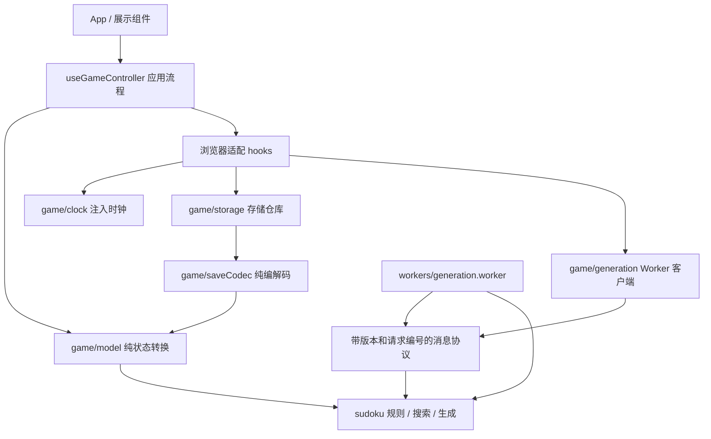

# 架构与底层逻辑

本轮重构将规则计算、对局状态、浏览器服务和界面分开。三种玩法、旧存档格式和交互入口保持兼容；后续修改规则或存储方式时，有明确的入口和验证边界。

## 分层与依赖



- `src/sudoku/` 不依赖 React、DOM 或存储。随机源和搜索时钟可以注入；默认值由搜索上下文提供。
- `src/game/model.ts` 接收明确的动作和时间戳，不读取系统时间、创建随机标识或执行 I/O。同一状态与动作产生相同结果。
- `src/game/saveCodec.ts` 只处理字符串与结构化数据，不读浏览器或系统时间；旧数据缺失的时间字段统一回退为 0。
- `src/game/clock.ts` 通过构造函数接收单调时钟，React 只负责驱动采样和生命周期。
- `src/hooks/` 连接状态与浏览器服务；`useGameController` 组织新建、切换、输入、暂停、存档等流程。视图通过它返回的状态和命令交互。
- `App` 组合屏幕；`GameDialogs` 负责弹窗内容；棋盘、单元格与工具栏负责展示和输入。视图不直接读写存档或启动 Worker。

核心模块通过具体函数、结构化结果和小型接口连接。没有引入通用事件总线、依赖注入容器或额外运行时依赖。

## 一份约束拓扑服务三种玩法

`compileTopology(regionMap, diagonal)` 将地图转换为不可变的约束拓扑：

- `houses`：每行、每列、每个区域，以及可选的两条对角线。
- `cellHouses`：每格所属的约束集合。
- `peers`：与每格共享约束的其他格子。
- `regions` 与 `signature`：经过校验的区域内容和缓存标识。

标准与异形棋盘各有 27 个约束，对角线棋盘有 29 个。对角线中心同时属于 5 个约束。区域必须各含 9 格并通过上下左右连通性校验。

验证、求解、挖空和棋盘高亮复用同一拓扑，避免各自维护行、列、区域、对角线分支。所有拓扑数组均冻结，缓存最多保留 64 个，采用 LRU 淘汰。缓存按地图内容和对角线模式索引；调用方修改原地图不会得到错误的旧拓扑，也不会修改已编译的数组。棋盘形状检查逐个验证 81 个自有索引，拒绝缺行、数组空洞和显式 `undefined`，不依赖会跳过空洞的 `every`。

`src/utils/sudoku.ts` 保留为兼容导出，新模块直接从 `src/sudoku/` 导入。

## 搜索与生成

`search` 将输入复制到本次搜索专属的 `Uint8Array` 棋盘和 `Uint16Array` 约束位掩码。候选值由所属约束的掩码计算，每次优先选择候选数最少的空格（MRV）。递归的 `finally` 恢复当前格和掩码，成功提前返回、取消和异常均经过同一恢复路径。搜索不会修改输入棋盘或缓存拓扑。

求完整答案时只寻找一个解并复制结果；验证唯一性时最多数到两个解，不复制无用的完整答案。`SearchContext` 为一次生成共享预算，默认最多 1,000,000 次搜索访问、5 秒；支持注入随机源、时钟及取消信号。预算必须是有限的非负数，随机源必须返回 `[0, 1)`。

每次挖空通过 `limitSearch` 另设 20,000 次访问的子预算，访问仍计入总预算。`SearchLimitError.scope` 区分单次验证与总预算耗尽，取消保持独立的 `AbortError`。子预算耗尽时恢复给定数，再尝试其他位置；总预算耗尽时也先恢复本次未验证的挖空，仅当已有棋盘保持唯一解且所有约束的给定数均为 1–7 时才返回该棋盘，否则报告失败。取消、其他异常以及完整答案尚未生成时的预算耗尽不会被当作成功。

异形区域从已知合法解出发，在不同区域间交换相等数字，校验区域连通性，并保留已发现的有效非标准地图。候选交换按数字分组，避免扫描所有不同数字的配对。挖空时维护每个约束的给定数计数，只更新当前格所属的约束，并逐次验证唯一解。最终难度仍由目标挖空数控制，约束可能阻止达到目标；没有加入人类技巧评级。

确定性来自显式注入的随机源。使用同一种子和相同引擎版本可以复现生成结果；不承诺跨算法版本的种子输出完全相同。

## 对局状态与撤销

`gameReducer` 是对局的状态转换入口。固定格、获胜棋盘和无效输入在这里被拒绝，无效动作直接返回原状态。新建会话由 `newSession` 复制棋盘与区域图，调用方提供标识和时间戳；应用适配层负责 `crypto.randomUUID()` 与 `Date.now()`。

每次编辑只复制变化的棋盘行、笔记行和笔记单元，其他行保留引用；仅修改笔记时保留整个棋盘引用。撤销记录保存 `{ cell, value, notes }`，不再保存整盘棋和笔记快照。最多保留 200 步；切换对局后清空，刷新后不恢复。该结构假定一次输入只修改一格；若以后加入自动清理同伴笔记，需要将一次动作扩展为多个单元变化，保证撤销的原子性。

计时更新按对局编号定位，拒绝时间倒退。`withCheckpoint` 只将属于对应对局且更大的有效计时值合入保存快照，不改动 reducer 状态。

棋盘按拓扑缓存边框对象，并保持每格 ref 与选择回调稳定，使 `memo(Cell)` 能跳过未改变的单元格。普通单格输入和笔记更新只重绘对应一格；冲突变化更新受影响的格子，选择变化仍正常更新同伴高亮。每格可访问名称包含区域编号及适用的对角线归属，异形棋盘另有明确名称；没有增加常驻可见介绍。

## 计时与 React 生命周期

`SessionClock` 以单调时钟记录运行区间。每秒更新用于显示，存档直接采样时钟，不依赖最近一次显示刷新。暂停时返回之前运行区间的精确检查点，恢复时保留不足一秒的部分；切换对局时先返回旧对局的检查点，再使用新对局的时间种子。

`useGameClock` 在布局阶段配置时钟，定时器清理只取消采样，不在卸载阶段 dispatch。`useCommittedRef` 同样在布局阶段更新引用，使浏览器事件读取已提交的状态和回调。持久化卸载时读取最后的时钟检查点并保存，不更新已卸载组件的状态。

手动暂停、弹窗、生成中和页面隐藏共同决定是否运行；关闭弹窗不会取消之前的手动暂停。

## 存档与并发边界

`decodeSave` / `encodeSave` 管理版本 2 格式及旧历史迁移。解码产生有效、损坏或不支持三种结果；区域、给定格、棋盘及时间字段经过校验，笔记经过清理。旧计时乘以 1000 后再次检查，计时上限为可安全表示的整数毫秒，日期上限为 JavaScript 支持的 `8_640_000_000_000_000` 毫秒；异常值使用确定的有限回退值，保留合法的小数毫秒。

损坏原文的备份和浏览器异常处理由 `storage.ts` 执行。新增恢复副本仅使用固定的五个槽位，写入前逐个比较内容去重。槽位满或备份失败时不淘汰旧副本，而是保护当前原文并禁用新写入；旧 UUID 后缀备份不自动删除。未知新版本直接保持原键只读，不在每次初始化时重复备份。

`SaveRepository` 暴露 `load` / `connect` / `save` 和存储键，并接受只需 `getItem` / `setItem` 的 `StoragePort`，以及可注入的 `SaveLockPort`。仓库自己执行只读保护和保存权检查，避免界面漏传状态时无保护写入。

`connect` 使用 [Web Locks API](https://www.w3.org/TR/web-locks/) 为同一源申请独占的 `sudoku_save_v2:writer` 锁，使用 `ifAvailable` 检查当前是否可获得保存权。锁在页面有效期内持续持有，因此写前检查与同步 `localStorage.setItem` 期间不存在另一个参与仲裁的写入者。其他标签页得到保存权冲突，停止写入并显示简短提示；已有内存修改保留到刷新为止。

仓库在异步获得锁之前、锁释放之后、浏览器不支持或拒绝锁访问时均禁止写入，不使用无锁降级。断开连接后到达的旧回调不会启用保存；重连等待之前的原生锁请求完全释放，防止 StrictMode 重放产生假冲突。`ifAvailable` 不能与取消信号组合，过期请求通过生命周期标记在回调中立即释放。

仓库仍保存最后一次读取或写入的原始字符串作为基线。持锁写入前重新读取并比较，变化时返回 `conflict`，相同内容跳过重复写入。这可以发现尚未送达 `storage` 事件的外部修改。原生锁只协调参与同一协议的页面，不约束旧版本标签页、外部工具或绕过仓库的直接存储写入；旧版本升级后应刷新所有旧标签页。当前策略不自动合并冲突棋盘，也没有新增跨设备同步。

`usePersistence` 负责锁连接的生命周期、两秒节流、页面隐藏/离开/卸载的刷新以及冲突状态，不了解时钟内部实现。锁请求期间的修改在获得保存权后读取最新已提交快照保存。`pagehide` 或卸载时先在锁内同步保存，再释放；从页面缓存恢复时重新连接，基线变化则拒绝覆盖。应用层提供合并计时后的快照函数。存档仍局限于同一浏览器和源，锁尚未获得时立即关闭、浏览器强制终止或存储失败不能保证落盘。

## Worker 协议与生成生命周期

每次请求使用独立的 module Worker，携带协议版本、请求编号、难度和题型。响应是成功或失败的可辨别联合类型。主线程验证版本、编号、结构、区域、完整答案与给定格的一致性，以及标准/对角线玩法的区域形状；畸形响应立即失败。唯一解验证留在 Worker 的生成流程中，不在 UI 线程重复搜索。

成功、错误、消息反序列化失败、发送失败、取消和 8 秒超时都进入同一清理函数，移除监听器并终止 Worker。应用 hook 使用请求序号和 `AbortController` 阻止过期结果更新会话。生成状态采用 `idle` / `running` / `failed` 联合类型，失败状态保留本次设置供用户重试。

## 验证与扩展

```sh
npm run check
npm run format:check
npm run benchmark --silent
```

回归覆盖纯状态转换、引用共享、单格撤销、独立解计数、拓扑缓存、确定性生成、子预算与总预算退出、计时精度、数值溢出、稀疏棋盘及 Worker 消息拒绝、生命周期清理、恢复副本去重与容量保护、延迟冲突事件，以及真实界面交互。组件测试计数验证单格编辑与冲突更新的实际重绘范围，并检查回调更新、焦点移动和读屏信息。

基准默认生成 450 道题（三种玩法 × 三档难度 × 50 个固定种子），输出本机时间、挖空范围、唯一解及约束检查结果。另用 200 次实际 reducer 编辑比较旧式整盘记录与单格记录的 JSON 编码大小。它不测量堆内存，也不是端到端浏览器性能测试。用 `SUDOKU_BENCH_SAMPLES` 可调整每组样本数，范围 1–1000；编译在内存中完成，不修改 `build/`。

扩展规则时先修改拓扑及其验证测试，再检查生成策略、协议、存档校验和展示是否需要适配。当前类型和棋盘尺寸明确限定为 9×9，拓扑抽象不意味着可以直接接入任意尺寸或任意约束。扩展存档字段时保持旧格式可读，需要改变不兼容语义时升级版本；替换存储适配时保留恢复、只读和冲突结果的行为契约。
